<!-- Gerado por scripts/build.py (SVGs) e scripts/anim (animação). Identidade visual: amorim-co.de -->

<a href="https://amorim-co.de"><picture><source media="(prefers-color-scheme: dark)" srcset="assets/hero-dark.gif"><source media="(prefers-color-scheme: light)" srcset="assets/hero-light.gif"></picture></a>

 

<picture><source media="(prefers-color-scheme: dark)" srcset="assets/intro-dark.svg"><source media="(prefers-color-scheme: light)" srcset="assets/intro-light.svg"></picture>

  <a href="https://amorim-co.de/#contato"><picture><source media="(prefers-color-scheme: dark)" srcset="assets/btn-conversa-dark.svg"><source media="(prefers-color-scheme: light)" srcset="assets/btn-conversa-light.svg"></picture></a>
  <a href="#trabalhos"><picture><source media="(prefers-color-scheme: dark)" srcset="assets/btn-trabalhos-dark.svg"><source media="(prefers-color-scheme: light)" srcset="assets/btn-trabalhos-light.svg"></picture></a>
  <a href="https://www.instagram.com/matheus_amorimcode/"><picture><source media="(prefers-color-scheme: dark)" srcset="assets/btn-instagram-dark.svg"><source media="(prefers-color-scheme: light)" srcset="assets/btn-instagram-light.svg"></picture></a>

 

<picture><source media="(prefers-color-scheme: dark)" srcset="assets/manifesto-dark.svg"><source media="(prefers-color-scheme: light)" srcset="assets/manifesto-light.svg"></picture>

  

<picture><source media="(prefers-color-scheme: dark)" srcset="assets/sec-trabalhos-dark.svg"><source media="(prefers-color-scheme: light)" srcset="assets/sec-trabalhos-light.svg"></picture>

<a href="https://estanagel.amorim-co.de"><picture><source media="(prefers-color-scheme: dark)" srcset="assets/work-estanagel-dark.svg"><source media="(prefers-color-scheme: light)" srcset="assets/work-estanagel-light.svg"></picture></a>

<a href="https://dimdim.art.br"><picture><source media="(prefers-color-scheme: dark)" srcset="assets/work-dimdim-dark.svg"><source media="(prefers-color-scheme: light)" srcset="assets/work-dimdim-light.svg"></picture></a>

<a href="https://amorim-co.de/#case-loja"><picture><source media="(prefers-color-scheme: dark)" srcset="assets/shop-dark.svg"><source media="(prefers-color-scheme: light)" srcset="assets/shop-light.svg"></picture></a>

  

<picture><source media="(prefers-color-scheme: dark)" srcset="assets/sigilo-dark.svg"><source media="(prefers-color-scheme: light)" srcset="assets/sigilo-light.svg"></picture>

  

<picture><source media="(prefers-color-scheme: dark)" srcset="assets/sec-faco-dark.svg"><source media="(prefers-color-scheme: light)" srcset="assets/sec-faco-light.svg"></picture>

<a href="https://amorim-co.de/#em-movimento"><picture><source media="(prefers-color-scheme: dark)" srcset="assets/problems-dark.svg"><source media="(prefers-color-scheme: light)" srcset="assets/problems-light.svg"></picture></a>

  

<picture><source media="(prefers-color-scheme: dark)" srcset="assets/stack-dark.svg"><source media="(prefers-color-scheme: light)" srcset="assets/stack-light.svg"></picture>

  

<picture><source media="(prefers-color-scheme: dark)" srcset="assets/sec-sobre-dark.svg"><source media="(prefers-color-scheme: light)" srcset="assets/sec-sobre-light.svg"></picture>

<picture><source media="(prefers-color-scheme: dark)" srcset="assets/stats-dark.svg"><source media="(prefers-color-scheme: light)" srcset="assets/stats-light.svg"></picture>

  

<a href="https://amorim-co.de/#contato"><picture><source media="(prefers-color-scheme: dark)" srcset="assets/cta-dark.svg"><source media="(prefers-color-scheme: light)" srcset="assets/cta-light.svg"></picture></a>

  

<a href="https://amorim-co.de"><picture><source media="(prefers-color-scheme: dark)" srcset="assets/footer-dark.svg"><source media="(prefers-color-scheme: light)" srcset="assets/footer-light.svg"></picture></a>
